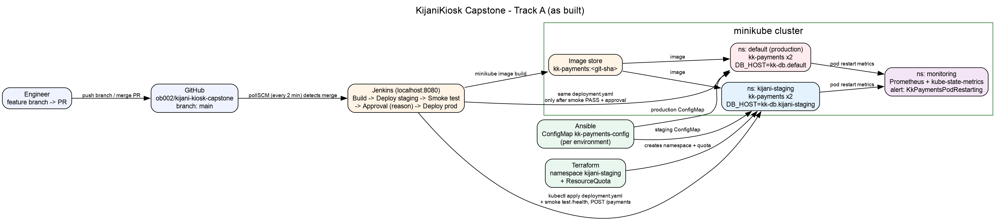

# KijaniKiosk Capstone — Track A (Infrastructure-First)

kk-payments runs in two isolated environments on one Kubernetes cluster:
`kijani-staging` (staging) and `default` (production). Every merge to `main`
deploys to staging automatically and runs a smoke test. The production approval
gate only appears if that smoke test passes.

## 1. Problem
Before this project, kk-payments changes went straight to production. There was
no staging environment, no smoke test, no recorded approval and no alerting.

## 2. Architecture


| Layer | Tool | Files |
|---|---|---|
| Infrastructure | Terraform creates the `kijani-staging` namespace and ResourceQuota | `infra/terraform/` |
| Configuration | Ansible applies a per-environment ConfigMap (different `DB_HOST`) | `infra/ansible/`, `k8s/config/` |
| Delivery | Jenkins: build → staging → smoke test → approval → production | `Jenkinsfile`, `scripts/smoke-test.sh` |
| Runtime | One `deployment.yaml` for both environments: probes, limits, JSON logs | `k8s/` |
| Monitoring | kube-prometheus-stack plus a pod-restart alert | `monitoring/alert-rules.yaml` |

**Key decision:** both environments use the *same* `k8s/deployment.yaml`. The
only difference is the namespace-local ConfigMap `kk-payments-config`. This
proves that what passed in staging is exactly what runs in production. The
trade-off is that it relies on a naming convention (the ConfigMap must have the
same name in both namespaces) instead of a tool like Kustomize that makes
environment differences explicit.

## 3. Prerequisites
| Tool | Tested version |
|---|---|
| minikube (docker driver) | v1.39.0, Kubernetes v1.37 |
| kubectl | 1.37 |
| Terraform | 1.17 |
| Ansible + `kubernetes.core` collection + `pip install kubernetes` | ansible-core 2.21 |
| Helm | 4.x |
| Jenkins (installed on the same machine, built-in node with 2 executors) | 2.580 |

## 4. Setup from a clean checkout
```bash
minikube start --driver=docker
git clone https://github.com/ob002/kijani-kiosk-capstone.git && cd kijani-kiosk-capstone

# Infrastructure
cd infra/terraform && terraform init && terraform apply -auto-approve && cd ../..
ansible-galaxy collection install kubernetes.core
pip install kubernetes
ansible-playbook infra/ansible/playbooks/configure-env.yml

# Monitoring
helm repo add prometheus-community https://prometheus-community.github.io/helm-charts
helm install monitoring prometheus-community/kube-prometheus-stack -n monitoring --create-namespace --set grafana.enabled=false --wait
kubectl apply -f monitoring/alert-rules.yaml
```

**Jenkins setup (one-time):**
```bash
# let the jenkins user reach the cluster
kubectl config view --flatten --minify > /tmp/kubeconfig-jenkins
sudo mkdir -p /var/lib/jenkins/.kube && sudo cp /tmp/kubeconfig-jenkins /var/lib/jenkins/.kube/config
sudo chown -R jenkins:jenkins /var/lib/jenkins/.kube
# let jenkins build images inside minikube (replace "user" with your login)
echo "jenkins ALL=(user) NOPASSWD: $(which minikube)" | sudo tee /etc/sudoers.d/jenkins-minikube
```
Then in Jenkins: New Item → Pipeline → *Pipeline script from SCM* → Git → this repo, branch `*/main`, script path `Jenkinsfile`. Run it once manually so `pollSCM` is registered.

## 5. Using the pipeline
1. Merge a PR into `main`. Within about 2 minutes Jenkins starts automatically (`pollSCM`).
2. Stages: Build Image (tag = git SHA) → Deploy to Staging → Smoke Test Staging → **Production Approval** → Deploy to Production (with its own smoke test).
3. Approve at `http://localhost:8080/job/kijani-kiosk-capstone/<build>/input/`. A reason is required and is saved in the build description. **The gate times out after 30 minutes.**

**Fault handling:** if the staging smoke test fails, Jenkins runs `rollout undo` on staging and skips the approval gate, so production is never touched. This was demonstrated in build #6, where the probe path was deliberately broken.

## 6. Monitoring
- Alert `KkPaymentsPodRestarting` fires when a kk-payments container restarts more than twice in 10 minutes.
- View it: `kubectl -n monitoring port-forward svc/monitoring-kube-prometheus-prometheus 9090:9090`, then open http://localhost:9090/alerts
- Logs are JSON: `kubectl -n kijani-staging logs deploy/kk-payments`

## 7. Troubleshooting and known gaps
| Symptom | Fix |
|---|---|
| `no route to host 192.168.49.2` | minikube is stopped: run `minikube start` |
| Jenkins build stuck on "Waiting for next available executor" | Another job is holding the executors. Disable it and clear the queue. |
| Approval build ends ABORTED | The 30-minute input timeout ran out. Re-run and approve sooner. |
| Pods `ErrImagePull` | Build the image into minikube: `minikube image build -t kk-payments:<tag> app/kk-payments` |

**Production gaps (not done):** staging and production share one cluster; there's no NetworkPolicy; Alertmanager has no receiver (alerts aren't sent anywhere); there's no real database (`DB_HOST` is configuration only); the receipt chain to S3 is not integrated.

AI tool usage is documented in [`docs/ai-governance-log.md`](docs/ai-governance-log.md).
